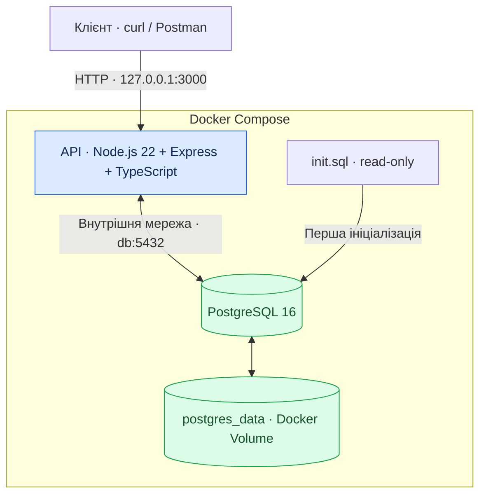
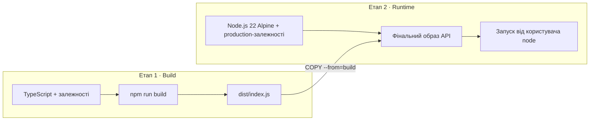
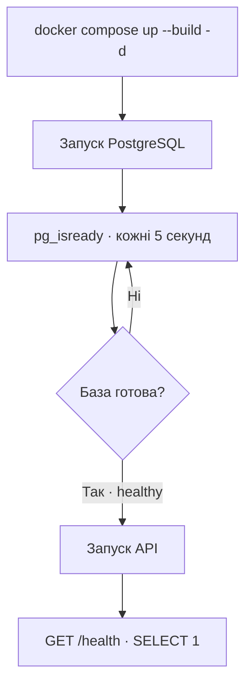
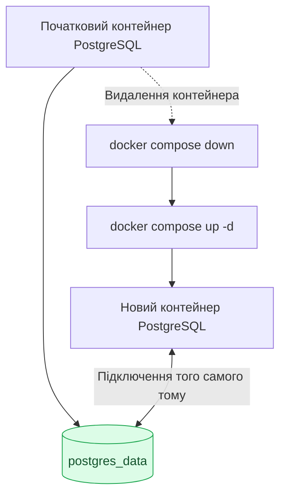
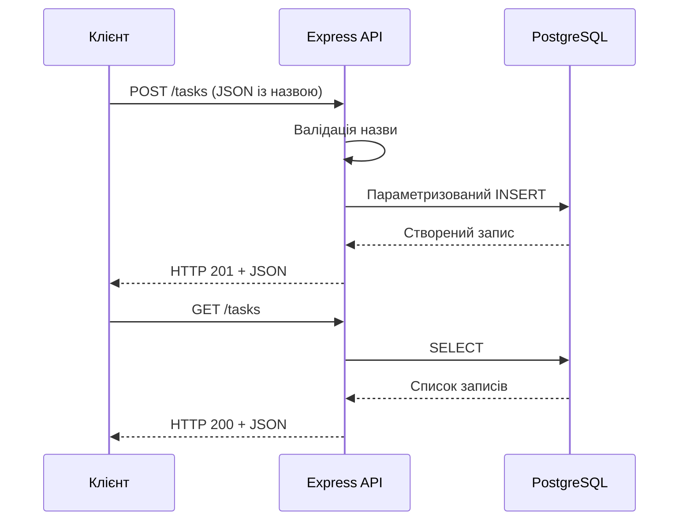
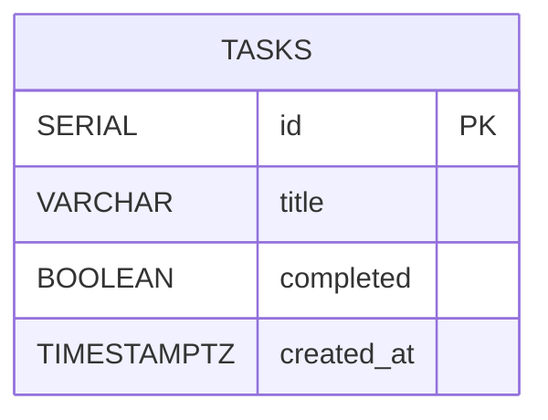

# Лабораторна робота: Контейнеризація вебзастосунку для хмарного середовища

**Виконав:** Фівко Артем, група 402  
**Дисципліна:** Хмарні технології

## Мета
Створити REST API на Node.js/TypeScript, підключити PostgreSQL і запустити сервіси в ізольованих Docker-контейнерах за допомогою Docker Compose. Дослідити health checks та постійне зберігання даних.

## Архітектура проєкту



API обробляє HTTP-запити, а PostgreSQL зберігає завдання. Docker Compose створює внутрішню мережу, в якій API знаходить базу за назвою сервісу `db`. Порт PostgreSQL не публікується на хості.

## Технології

| Технологія | Призначення |
|---|---|
| Node.js / TypeScript | Серверна логіка та типізація |
| Express | HTTP-сервер і REST API |
| PostgreSQL | Реляційна база даних |
| Docker | Ізоляція та переносимість застосунку |
| Docker Compose | Спільний запуск сервісів |
| Alpine Linux | Компактні базові образи |

## Структура репозиторію

| Файл | Призначення |
|---|---|
| `src/index.ts` | Маршрути API, валідація, SQL-запити |
| `Dockerfile` | Багатоетапна збірка образу API |
| `compose.yaml` | Сервіси, мережа, порти, томи та healthcheck |
| `init.sql` | Створення таблиці tasks |
| `package.json` | Залежності та команди npm |
| `tsconfig.json` | Конфігурація компілятора |
| `.env.example` | Шаблон змінних середовища |
| `.dockerignore`, `.gitignore` | Виключення локальних і службових файлів |

## Багатоетапна збірка (Multi-stage build)



Компілятор TypeScript та інструменти розробки не потрапляють у фінальний образ. Це зменшує його розмір і поверхню атаки.

## Послідовність запуску та Healthcheck



У Compose задано `depends_on: condition: service_healthy`. Перевірка PostgreSQL має таймаут 3 секунди та 10 невдалих спроб до статусу unhealthy. Маршрут API `/health` окремо перевіряє можливість виконати SQL-запит.

## Постійне зберігання даних



Іменований том підключається до `/var/lib/postgresql/data`. Дані залишаються після звичайного видалення та повторного створення контейнера. Файл `init.sql` підключається лише для читання і виконується при першій ініціалізації порожньої бази.

## REST API

| Метод | Маршрут | Дія | Успішний HTTP-статус |
|---|---|---|---|
| GET | `/health` | Перевірити підключення до БД | 200 |
| GET | `/tasks` | Отримати список завдань | 200 |
| POST | `/tasks` | Створити завдання | 201 |
| PATCH | `/tasks/:id` | Оновити статус виконання | 200 |



Для роботи з базою використовується пул підключень `pg.Pool`. Параметризовані SQL-запити відокремлюють дані користувача від SQL-коду. Некоректні дані повертають 400, відсутнє завдання — 404, помилка бази — 500, а недоступність БД у health endpoint — 503.

## Модель даних



Поле `title` обмежене 200 символами; `completed` за замовчуванням має значення false, а `created_at` встановлюється автоматично.

## Підготовка
Потрібен Docker Desktop або Docker Engine з Compose. Перевірити: `docker --version` і `docker compose version`.

## Запуск
```bash
cp .env.example .env
# Для локального тесту можна залишити приклад, для публічного сервера обов'язково змінити пароль
 docker compose up --build -d
 docker compose ps
```

## Тестування
```bash
curl http://localhost:3000/health
curl -X POST http://localhost:3000/tasks -H 'Content-Type: application/json' -d '{"title":"Перевірити Docker Compose"}'
curl http://localhost:3000/tasks
curl -X PATCH http://localhost:3000/tasks/1 -H 'Content-Type: application/json' -d '{"completed":true}'
curl http://localhost:3000/tasks
```

У PATCH-запиті замініть ID 1 на фактичний ID створеного завдання, якщо він відрізняється.

## Перевірка збереження даних
```bash
docker compose restart
curl http://localhost:3000/tasks
```
Після перезапуску дані повинні залишитися завдяки іменованому тому `postgres_data`. Для зупинки: `docker compose down`. **Не використовувати `docker compose down -v`, якщо дані потрібно зберегти.**

## Що продемонструвати викладачу
1. `docker compose ps`: обидва сервіси запущені.
2. `/health`: API успішно підключається до PostgreSQL.
3. `POST /tasks`: створення запису.
4. `GET /tasks`: читання з бази даних.
5. `PATCH /tasks/1`: оновлення статусу.
6. `docker compose restart` і повторний `GET /tasks`: дані збережено.

Зробіть власні скриншоти команд і відповідей у папці `screenshots/`. Результати не заявляються як перевірені, поки ви не запустите проєкт.

## Висновок
У роботі реалізовано двосервісну контейнеризовану архітектуру з API, базою даних, перевіркою готовності PostgreSQL та постійним зберіганням даних. Docker Compose дає змогу відтворити середовище на іншому комп'ютері або сервері. Для повноцінного хмарного розгортання потрібні окремий хмарний хостинг, налаштування секретів, HTTPS та мережевої безпеки.
